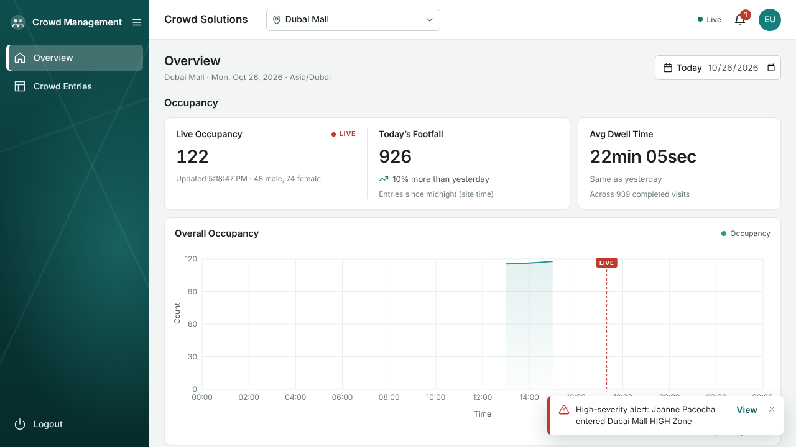

# Crowd Management System – Dashboard

A responsive single-page dashboard for venue operators. It shows live occupancy, today's footfall, average dwell time, hourly occupancy and demographic trends, and visitor-level entry/exit records, with real-time alerts over Socket.IO.

The backend APIs are the only source of truth. The UI computes no business metrics of its own.



---

## 1. Overview and purpose

This is the frontend for the _Crowd Management System_ problem statement, covering three screens:

| Screen            | What it answers                                                                                                                                        |
| ----------------- | ------------------------------------------------------------------------------------------------------------------------------------------------------ |
| **Login**         | Secure entry for each partner account.                                                                                                                 |
| **Overview**      | How crowded is the venue now? Is today busier than yesterday? What is the average dwell time? How do occupancy and gender split change during the day? |
| **Crowd Entries** | Who entered and exited, when, and for how long? Who is still inside?                                                                                   |

## 2. Features

- **Authentication.** Email + password login validated with React Hook Form and Zod.
  - Masked password with a visibility toggle, loading state, and an inline error on bad credentials.
  - Protected routes, and a safe redirect back to the requested page after login.
  - Logout, plus automatic sign-out when the JWT expires or the backend rejects the token (401/403).
- **Overview KPIs.**
  - **Live Occupancy** comes from the `live_occupancy` socket event, with Live/Stale badges. No comparison is shown, because there's no like-for-like backend baseline.
  - **Today's Footfall** and **Avg Dwell Time** come from REST.
  - Each KPI shows a "vs same time yesterday" indicator. It is computed from a second backend call for the same-length window on the previous day.
- **Occupancy chart.** Hourly averages over a full-day time axis in the site's time zone. It has axis labels, tooltips, a LIVE marker at the current time, empty and error states, and a screen-reader data table.
- **Demographics.** A donut for the latest hourly bucket and a male-vs-female area chart over the day. Missing categories are treated as 0.
- **Date control.** Any past day (the API accepts any UTC range). Live features switch off for past days.
- **Site selector.** All sites from `GET /api/sites`. Site and day are stored in the URL (`?site=…&date=…`), so views can be linked.
- **Crowd Entries.**
  - **Server-side pagination** with selectable page size (10/25/50).
  - **Stable pages:** the time window is frozen while you page, so pages don't shift as new visitors arrive. **Refresh** moves it to "now".
  - **Smooth paging:** the previous page stays on screen while the next one loads.
  - **Missing exits:** visitors who haven't left show `--`.
  - **States:** dedicated empty, error and retry states.
- **Real-time.**
  - **One managed Socket.IO connection** with a visible status: Connecting / Live / Reconnecting / Disconnected (with a Reconnect button) / Session expired.
  - **Validated events only:** payloads are checked before they reach the UI, and malformed events are dropped.
  - **Alerts:** a bell with an unread count and an accessible drawer listing zone, direction and severity as text.
  - **Low-noise toasts:** only _high-severity_ alerts for the selected site raise a toast, and bursts within 8 s are coalesced into one.
- **Data freshness.** Every chart shows "Updated 2m ago" / "Refreshing…" / "Couldn't refresh · showing data from …".
- **Responsive and accessible.**
  - Desktop-first, with a collapsible sidebar and a mobile drawer.
  - Semantic landmarks, a skip link and visible focus.
  - Keyboard operable; the native `<dialog>` provides the focus trap and Esc.
  - Charts carry text alternatives, and no state is conveyed by colour alone.

## 3. Technology stack

| Concern      | Choice                                                                                                                            |
| ------------ | --------------------------------------------------------------------------------------------------------------------------------- |
| UI           | React 19, TypeScript 6 (strict)                                                                                                   |
| Build        | Vite 8                                                                                                                            |
| Routing      | React Router 8 (data router, lazy routes)                                                                                         |
| Server state | TanStack Query 5                                                                                                                  |
| HTTP         | Fetch-based client (`src/services/api/httpClient.ts`) with timeout, cancellation, error normalization and Zod response validation |
| Real-time    | socket.io-client 4.8 (staging server runs Socket.IO 4.8.1)                                                                        |
| Charts       | Recharts 3                                                                                                                        |
| Forms        | React Hook Form 7 + Zod 4                                                                                                         |
| Styling      | CSS Modules + global design tokens (`src/styles/global.css`)                                                                      |
| Tests        | Vitest 5, React Testing Library, MSW 3, Playwright 1.63                                                                           |
| Quality      | ESLint 9 (typescript-eslint strict-type-checked, react-hooks, jsx-a11y, TanStack Query rules), Prettier                           |

## 4. Architecture and folder structure

```
src/
  app/                    App.tsx, router.tsx (lazy routes), RouteError, providers/
    providers/            AppProviders, queryClient (retry policy), RealtimeProvider (socket lifecycle)
  components/
    ui/                   Button, Card, Icon, Pagination, Skeleton
    layout/               AppLayout, Sidebar, Header, PageHeader, BrandMark
    feedback/             ErrorState, EmptyState, DataFreshness
    charts/               ChartTooltip, ChartLegend, ChartDataTable, LiveMarkerLabel, chartTheme
  features/
    auth/                 session (storage + JWT claims), sessionStore, AuthProvider, LoginPage/Form, ProtectedRoute
    sites/                sites service + query, URL-backed site/day selection, SiteSelect, DateControl
    dashboard/            metrics service, KPI tiles, comparison queries, realtime-driven refresh
    occupancy/            occupancy service/query/chart, live occupancy store
    demographics/         demographics service/query, donut + trend charts
    crowd-entries/        entries service, paginated query, table, page
    alerts/               alerts store, bell, drawer, toaster, connection status
  services/
    api/                  httpClient, errors (ApiError), queryKeys
    socket/               RealtimeClient, typed event schemas, connection-status hook
  types/api.ts            Zod contracts + inferred types for every REST response
  utils/                  time (time-zone-aware day windows, DST-safe), format, pagination
  constants/config.ts     validated env + tuning constants
  hooks/useNow.ts
tests/
  unit/                   utils, contracts, httpClient, RealtimeClient, session, stores
  integration/            auth, dashboard, crowd entries (real route tree + MSW + fake socket)
  e2e/                    Playwright: mocked critical path + gated staging run
  fixtures/staging.ts     payloads captured from the staging API
```

**Design rules:**

- **Components never call the API.** Services (`features/*/services`) wrap the HTTP client. Hooks (`features/*/hooks`) own TanStack Query, and components render state.
- **Server state lives in TanStack Query.** UI state is local `useState` or the URL. The socket-fed stores (`liveOccupancyStore`, `alertsStore`) are small external stores read through `useSyncExternalStore`, subscribed per site, so events for other sites never re-render the view.
- **`sessionStore` is framework-agnostic.** The HTTP client reads the token from it synchronously, so the first request after a reload is already authenticated.
- **`RealtimeClient` owns the single socket.** It registers exactly one native listener per event, fans out to app subscribers, validates payloads, and exposes status.

## 5. Prerequisites

- Node.js **≥ 20.19** (developed on 22.23) and npm 10+.
- For e2e: Playwright's Chromium (`npx playwright install chromium` on a fresh machine).

## 6. Installation

```bash
npm install
cp .env.example .env     # then edit if your backend URL differs
```

## 7. Environment variables

| Variable                    | Required | Purpose                                                                                                                            |
| --------------------------- | -------- | ---------------------------------------------------------------------------------------------------------------------------------- |
| `VITE_API_BASE_URL`         | yes      | REST origin, e.g. `https://hiring-dev.internal.kloudspot.com`                                                                      |
| `VITE_SOCKET_URL`           | no       | Socket.IO origin; defaults to `VITE_API_BASE_URL`                                                                                  |
| `E2E_EMAIL`, `E2E_PASSWORD` | e2e only | Staging account for `tests/e2e/staging.spec.ts`. Shell or CI secrets only; never `VITE_`-prefixed, never bundled, never committed. |
| `E2E_BASE_URL`              | e2e only | Run Playwright against an already-running or deployed app instead of a local build                                                 |

Both `VITE_` variables are public, non-secret URLs. They're validated at startup (`src/constants/config.ts`), and a bad value fails fast with a clear message. The committed `.env.test` and `.env.e2e` point at fake hosts that only exist inside the mocked test suites.

## 8. API base URL configuration

Set `VITE_API_BASE_URL` in `.env` locally, or in the Vercel project settings. The value is inlined at build time, so changing it requires a rebuild. The staging backend sends `Access-Control-Allow-Origin: *`, so the app can be served from any origin.

## 9. Authentication flow and assumptions

1. `POST /api/auth/login` with `{ email, password }` returns `{ token }`, a JWT. The claims observed on staging are `sub, email, name, role, iat, exp`, with a **1-hour** lifetime.
2. The token is sent as `Authorization: Bearer <token>` on every REST call and in the Socket.IO handshake (`auth: { token }`).
3. **Storage:** the session (token, email, name, expiry) is kept in **sessionStorage**. It survives a reload but ends when the tab closes. This is not a security boundary, since any script on the origin can read it. Protection comes from not rendering untrusted HTML and from host-level headers (see section 20).
4. **Session end:** the app signs out automatically at the JWT `exp`. It also signs out when an authenticated call returns **401** (missing token) or **403** `"Invalid or expired token"`, which is what staging returns for expired or invalid tokens, and when the socket handshake fails with `"Authentication error"`. The query cache is cleared on every sign-out.
5. **No refresh flow:** the backend documents no refresh endpoint, so none is invented. The user signs in again.
6. **Route protection is a UX guard only.** The backend enforces authorization on every request.

## 10. API endpoint contracts

All verified against Swagger **and** live staging responses (fixtures in `tests/fixtures/staging.ts`, validated by `tests/unit/services/contracts.test.ts`). Every analytics body is `{ siteId: string, fromUtc: number, toUtc: number }` with epoch-millisecond values.

| Method & path                      | Response (validated fields)                                                                                                                                                                      | Used for                                 |
| ---------------------------------- | ------------------------------------------------------------------------------------------------------------------------------------------------------------------------------------------------ | ---------------------------------------- |
| `POST /api/auth/login`             | `{ token }` · 401 `{ errorMessage: "Invalid credentials" }`                                                                                                                                      | Login                                    |
| `GET /api/sites`                   | `[{ siteId, name, city, country, timezone, zones[] }]`                                                                                                                                           | Site selector, time zone                 |
| `POST /api/analytics/footfall`     | `{ footfall }` (count of entry events)                                                                                                                                                           | Today's Footfall (+ previous-day window) |
| `POST /api/analytics/dwell`        | `{ avgDwellMinutes, dwellRecords }`                                                                                                                                                              | Avg Dwell Time (+ previous-day window)   |
| `POST /api/analytics/occupancy`    | `{ timezone, buckets: [{ utc, local, avg }] }` (hourly)                                                                                                                                          | Occupancy chart                          |
| `POST /api/analytics/demographics` | `{ timezone, buckets: [{ utc, local, male, female }] }` (hourly)                                                                                                                                 | Donut (latest bucket) + trend            |
| `POST /api/analytics/entry-exit`   | `+ pageNumber, pageSize` → `{ totalRecords, totalPages, pageNumber, pageSize, records: [{ personId, personName, gender, zoneName, severity, entryUtc, exitUtc\|null, dwellMinutes\|null, … }] }` | Crowd Entries                            |

**Error shapes vary by route:** `{ errorMessage }`, `{ message }` or `{ error }` (e.g. `400 { "error": "siteId required" }`). `src/services/api/errors.ts` normalizes them into an `ApiError` with a `kind` of `network`, `timeout`, `unauthorized`, `bad_request`, `server`, `http` or `invalid_response`.

**Behaviours observed on staging that the client accounts for:**

- **Time strings:** `entryLocal`/`exitLocal` are formatted in **UTC**, while occupancy `local` strings are site-local. The UI therefore formats the epoch fields with the site's IANA time zone.
- **Unknown or reversed inputs:** an unknown `siteId` returns 200 with zeros, and a reversed range returns empty buckets.
- **Pagination quirks:** pagination is 1-based, `pageSize` has no server cap, and string numbers are mishandled. `entriesService` clamps the page number to ≥ 1 and the page size to 1–100 integers.
- **Retries:** analytics POSTs are read-only. TanStack Query retries them **once**, and only for network, timeout or 5xx errors. 4xx responses, contract errors and login are never retried.

## 11. Socket.IO connection and events

- **Connection:** `io(VITE_SOCKET_URL, { auth: { token }, transports: ['websocket', 'polling'] })`. The client library is lazy-loaded after sign-in.
- **Handshake rejection:** a missing or invalid token gives `connect_error` with message `"Authentication error"`. That maps to status `unauthorized`, and the user is signed out.
- **Server → client events.** The server broadcasts for **all** sites; the UI filters by the selected site.

| Event            | Payload                                                                                                                                    |
| ---------------- | ------------------------------------------------------------------------------------------------------------------------------------------ |
| `alert`          | `{ ts, eventId, direction: 'entry'\|'exit', personId, personName, severity: 'high'\|'medium'\|'low', zoneId, zoneName, siteId, siteName }` |
| `live_occupancy` | `{ ts, siteId, siteOccupancy, zoneId, zoneOccupancy, genderCount: { male, female } }`                                                      |

- **Ignored event:** the server also emits an undocumented `sim:event`, a duplicate of `alert` plus `type`. It's ignored.
- **Reconnection** uses socket.io's built-in backoff (1–10 s). After a successful _re_-connect, analytics queries are invalidated to cover any missed interval. A server-side disconnect isn't retried by the library, so the UI offers **Reconnect**.
- **No duplicates:** `connect()` is idempotent per token, and a `disconnect()` during the lazy import cancels the pending connect. React StrictMode can't open a second socket.

## 12. Pagination and data-refresh behaviour

- **Crowd Entries** are fetched page by page from the server, with the page and page size in the query key. The window end (`asOf`) is frozen when the view opens. Each page has its own cache entry, so a slow response for an old page can never replace the page you asked for (covered by a test).
- **No polling.** Dashboard data is refreshed by events:
  - **Entry and exit alerts** for the selected site trigger a throttled refetch (at most once per 60 s) of today's footfall and dwell. Only the current-window values are refetched, not the comparisons.
  - **Hourly series** are refetched just after each hour boundary, when a new bucket exists.
  - **After a socket reconnect,** all analytics are refetched.
  - **On window focus,** data refetches if it is stale (older than 60 s).
- **Comparison windows** ("same time yesterday") are cached for 5 minutes.
- **Request priority.** Staging analytics calls take **1.3–4.4 s each**, and concurrent calls are processed one after another. Four in parallel took about 7.9 s, and the original six-call batch about 12 s. So the comparison calls are _dependent_ queries that start only after their primary value loads, and the headline numbers render first. The per-request timeout is 30 s.

## 13. Local development

```bash
npm run dev            # http://localhost:5173 (uses .env)
```

## 14. npm scripts

| Script                | Does                                                                           |
| --------------------- | ------------------------------------------------------------------------------ |
| `dev`                 | Vite dev server                                                                |
| `build`               | `tsc -b` + production build to `dist/`                                         |
| `build:e2e`           | Production build in `e2e` mode (fake API host for the mocked Playwright suite) |
| `preview`             | Serve `dist/`                                                                  |
| `typecheck`           | `tsc -b` over app, tests and configs                                           |
| `lint`                | ESLint, zero warnings allowed                                                  |
| `format`              | Prettier                                                                       |
| `test` / `test:watch` | Vitest unit + integration                                                      |
| `test:e2e`            | Playwright                                                                     |
| `verify`              | typecheck → lint → test → build                                                |